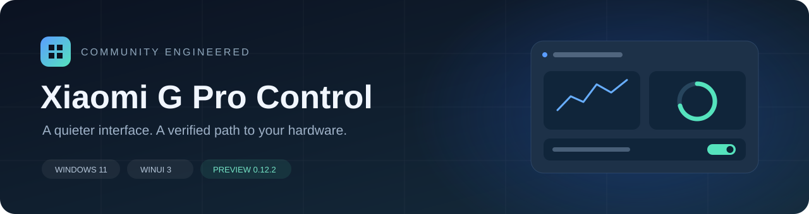
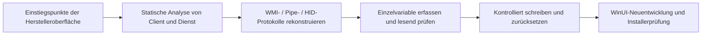

<div align="center">

[English](README.md) · [简体中文](README.zh-CN.md) · [日本語](README.ja.md) · **Deutsch** · [Русский](README.ru.md)



# XiaomiGProControl

**Ein neu entwickeltes Control Center im Windows-11-Stil für das Redmi G Pro 2024**

Eine übersichtliche Oberfläche, geprüfte Hardwareprotokolle und nachvollziehbare Reverse-Engineering-Dokumentation.


[Funktionsstatus](#funktionsstatus) · [Erste Schritte](#erste-schritte) · [Reverse Engineering](docs/reverse-engineering.md) · [Architektur](docs/implementation.md) · [Validierung](docs/verification.md)

</div>

---


## Über das Projekt

XiaomiGProControl ist eine inoffizielle Neuentwicklung des Control Centers für das **Redmi G Pro 2024 / TM2211**.
Die Implementierung basiert auf Erkenntnissen aus der Originalanwendung, dem Hintergrunddienst,
BIOS-ACPI/WMI und der HID-Kommunikation. Häufig verwendete Funktionen wurden mit C#, WinUI 3 und
einem Mica-Hintergrund neu umgesetzt. Protokollanalysen, korrigierte Annahmen und Prüfverfahren sind dokumentiert.

Kompatible Herstellerdienste und Treiber werden benötigt. Der unterstützte Umfang beschränkt sich auf
diese Notebookfamilie; die Anwendung ersetzt keine BIOS- oder EC-Firmware.

## Funktionsstatus

- Werksvoreinstellungen als Karten mit Standardwerten, sieben Einzelfarben, drei Farbverläufen und einer Rücksetzfunktion.

| Funktion | Status | Umsetzung |
| --- | --- | --- |
| Technische Daten | Implementiert und geprüft | Lokale CPU/GPU/RAM/Laufwerk/Display/BIOS/Windows-Daten; Berichte ohne Geräteseriennummer |
| Meine Dienste | Implementiert | Offizielle Handbücher, Servicebedingungen, Standorte, Support, Treiber und Konto; lokale Diagnoseübersicht |
| Vier Leistungsprofile | An Hardware validiert | Leise / Ausgewogen / Turbo / Volle Leistung; Rücklesen nach Schreibzugriffen |
| CPU-Temperatur und zwei Lüfterdrehzahlen | An Hardware validiert | Hersteller-EC `0x0900`, lesender WMI-Zugriff mit Administratorrechten |
| GPU-Messwerte | Implementiert | NVML: Auslastung, Temperatur, Leistung und VRAM |
| CPU / Arbeitsspeicher / Datenträger / Netzwerk | Implementiert | Lokale Messung; keine Übertragung von Telemetrie |
| Display-Overdrive | An Hardware validiert | Ausführung über den Herstellerdienst mit zugeordneter Statusmeldung |
| Fn / Windows-Tastensperre / Touchpad | Implementiert und validiert | Firmwarestatus bei Rückkehr zur Seite und nach Schreibzugriffen lesen; Windows-Tasten-Rundlauf und Seitennavigation geprüft |
| GPU-Ausgabemodus | Implementiert | `0=Hybrid`, `1=direkte Ausgabe über die dedizierte GPU`; Lese-/Schreibbestätigung, Neustart erforderlich |
| Normale Tastaturbeleuchtung | An Hardware validiert | Neun Hardwareeffekte und frei wählbare RGB-Beleuchtung; jeweils unterstützte Palette, Richtung, Helligkeit, Geschwindigkeit und Länge |
| Bildschirm- / Audiobeleuchtung | Implementiert und geprüft | Bildschirmmittelwert, Wiedergabe/Mikrofon, 17-Band-Vorschau und vier Farbverläufe; Ausgabe einheitlich oder nach Sichtprüfung pro Taste |
| Wiederherstellung beim Start | Implementiert | Leistungsprofil und gespeicherte Tastaturbeleuchtung; vollständige Neustartprüfung noch ausstehend |
| Schließdialog und Infobereich | Implementiert | Beenden / im Hintergrund ausführen / abbrechen; Auswahl optional merken und in den Einstellungen ändern |
| Mit Windows starten | Implementiert | Aufgabe mit erhöhten Rechten bei Anmeldung des aktuellen Benutzers; optionaler Hintergrundstart |
| WLAN-Beschleunigung | Statusabfrage | Status der Xiaomi-Router-Beschleunigung über den Herstellerpfad; kein erzwungener Schalter |
| Eigene Lüfterkurven / feste RPM | Nicht implementiert | Ein sicher überprüfbares Schreibprotokoll ist noch nicht bekannt |
| Bildschirmabbildung pro Taste / Spektrumbalken | Implementiert; Sichtprüfung erforderlich | 7×17-Matrix, vier Richtungen und Paletten; Aktivierung nach wiederherstellbarem Anzeigetest |
| Gehäusebeleuchtung | Nicht implementiert | Nicht Teil dieses Tastatur-Updates |

Hardwarevalidierung gilt für das dokumentierte Gerät und die getesteten Softwareversionen. Daraus folgt
keine Kompatibilität mit jeder Konfiguration. Die Grenzen stehen im [Validierungsprotokoll](docs/verification.md).

## Oberfläche und Verhalten

- Windows-11-Mica, abgerundete Karten, kompakte Navigation sowie helles und dunkles Design.
- Seiten für Übersicht, Leistung, Beleuchtung, Gerät und Einstellungen.
- Hauptseiten halten die Seitennavigation synchron; Zurück ist nur für ausdrücklich aufgerufene Unterseiten vorgesehen.
- Geräte- und Leistungsseite teilen sich die GPU-Steuerung mit gespeichertem Firmwarewert und Neustarthinweis.
- Beleuchtungsänderungen sichern den Ausgangszustand, prüfen die Änderung und stellen die Sicherung bei Fehlern wieder her.
- Erfolgreich angewendete Beleuchtungseinstellungen werden gespeichert; die Wiederherstellung beim Start lässt sich getrennt deaktivieren.
- Zwölf Beleuchtungsmodi. Beim Stoppen eines Bildschirm-/Audioeffekts oder beim Beenden wird der vorherige normale Effekt wiederhergestellt. Animationsbilder werden nicht in den Tastatur-Flash geschrieben.
- Beim Schließen kann zwischen Beenden und Hintergrundbetrieb gewählt werden. Die Auswahl lässt sich merken und in den Einstellungen zurücksetzen.
- Ein Klick auf das Symbol im Infobereich stellt das Fenster wieder her; das Kontextmenü bietet Beenden an. Erneutes Öffnen des installierten Launchers stellt das Fenster ebenfalls wieder her.
- Der Autostart kann deaktiviert oder auf Hintergrundstart eingestellt werden. Ein manueller Start zeigt das Hauptfenster.

## Erste Schritte

### Voraussetzungen

| Element | Validierte Konfiguration |
| --- | --- |
| Betriebssystem | Windows 11 x64 |
| Gerät | Redmi G Pro 2024, Mainboard `TM2211` |
| Hersteller-Control-Center | `2.1.1.418` |
| Herstellerdienst | `MiDeviceService 4.1.1.640` |
| RGB-Tastatur | `VID_1A86 / PID_E302 / MI_02`, Hardwareversion `01.13` |
| Berechtigungen | Administratorrechte für EC/WMI |

### Installation

Die aktuelle Version heißt `GProControl-0.13.3-Setup-x64.exe` und steht in der
[Veröffentlichung v0.13.3](https://github.com/Memories-white/XiaomiGProControl/releases/tag/v0.13.3) bereit.
Der englische/chinesische Inno-Setup-Assistent enthält die .NET- und Windows-App-SDK-Laufzeitumgebungen.
Installerdateien gehören zu den Release-Anhängen und werden nicht im Git-Quellverlauf gespeichert.

Nach der Installation kann die Anwendung optional gestartet werden; standardmäßig bleibt sie geschlossen.
Auch ein interaktives Upgrade bietet diese Auswahl nach Abschluss an.

Der äußere Installer und der Anwendungslauncher fordern bereits vor dem Entpacken Administratorrechte an.
Der Autostart verwendet eine Aufgabe mit höchsten Rechten für den aktuellen Benutzer; eine manuelle
Einstellung am Shortcut ist nicht erforderlich.

Im Installationsstamm liegt der Launcher; DLLs, Sprachen und Oberflächenressourcen werden in Unterordnern
gruppiert. Die Installation erstellt einen WinUI-kompatiblen Laufzeitcache. Bei der Deinstallation wird
der passende Cache entfernt, während Benutzereinstellungen erhalten bleiben. Details: [Installeraufbau](docs/installer-layout.md).

Upgrades verwenden das vorhandene Verzeichnis, ersetzen Programmdateien automatisch und entfernen
ausgemusterte Dateien anhand des Bestands eigener Dateien. Einstellungen und nicht aufgeführte
Zusatzdateien bleiben erhalten. Ergebnisse: [Validierungsprotokoll](docs/verification.md).

### Aus dem Quellcode bauen

Erforderlich sind Windows, das .NET 10 SDK und das passende Windows SDK.

```powershell
dotnet restore GProControl/GProControl.csproj -p:Platform=x64
dotnet build GProControl/GProControl.csproj -c Release -p:Platform=x64 --no-restore
```

Ausgabe: `GProControl/bin/x64/Release/net10.0-windows10.0.19041.0/`.
Entwicklungsbuilds behalten die native WinUI-Dateistruktur; der Installer verwendet die gruppierte Struktur.

### Offlinetests

```powershell
dotnet run --project tests/GProControl.ProtocolSmokeTests -c Release
dotnet run --project tests/GProControl.HardwareLogTests -c Release
```

Diese beiden Tests schreiben nicht auf Hardware. Sie prüfen Protokollgrenzen, Aufzählungswerte,
inkrementelle Logauswertung und das Speichern von Einstellungen. Programme mit den Namen
`HardwareSmokeTests` oder `LightingProbe` können reale Hardware ansprechen oder beschreiben.
Vor der Nutzung die [Teststufen](docs/verification.md) lesen. Die CI baut die Anwendung und führt nur Offlinetests aus.

## Reverse-Engineering-Ablauf



Bei der Analyse wurden mehrere Annahmen korrigiert: Der WMI-Proxy verwendet nicht den Befehlstyp 3;
für Leistungsmodi gibt es drei unterschiedliche Enum-Zuordnungen; Beleuchtungs-CMD 12 ist kein
Tastatur-Bearbeitungsmodus. Die Erkenntnisse stehen in der [Reverse-Engineering-Dokumentation](docs/reverse-engineering.md).

## Projektstruktur

```text
XiaomiGProControl/
├─ GProControl/                  WinUI-3-Anwendung
│  ├─ Models/                    Zustands- und Einstellungsmodelle
│  ├─ Protocol/                  Protokollcodecs und Enums
│  ├─ Services/                  Herstelleranbindung, HID, Messwerte, Einstellungen, Startwiederherstellung
│  ├─ Views/                     Seiten und gemeinsame GPU-Steuerung
│  └─ Assets/                    Anwendungssymbole
├─ tests/                        Offlinetests, lesende Prüfprogramme, kontrollierte Hardwaretests
├─ scripts/                      Build-, Paket-, Aufzeichnungs- und Ghidra-Skripte
├─ packaging/                    Inno-Setup-Installer und native Launcher
├─ tools/                        Projekteigene Symbolerstellung und Offline-Firmwareentpackung
├─ docs/                         Analyse- und Implementierungsdokumentation
└─ .github/                      CI und Issue-Vorlagen
```

Lokale Analyseeingaben, Dekompilierungsausgaben, Drittanbieter-Binärdateien und Buildprodukte unter
`.analysis*`, `analysis-*`, `.tools`, `bin`, `obj` und `artifacts` werden nicht als Quellcode verteilt.

## Dokumentation

Die README ist auf Englisch, vereinfachtem Chinesisch, Japanisch, Deutsch und Russisch verfügbar.
Die folgenden Detaildokumente behalten ihre chinesische oder englische Originalsprache.

| Dokument | Inhalt |
| --- | --- |
| [Reverse Engineering](docs/reverse-engineering.md) | Methoden, Belege, Korrekturen und Protokollfunde |
| [Implementierung und Architektur](docs/implementation.md) | Modulgrenzen, Struktur, Datenfluss und Paketierung |
| [Validierung](docs/verification.md) | Geprüftes Verhalten, offene Punkte und Testmethoden |
| [Dienst-Pipe-Protokoll](docs/service-pipe-protocol.md) | GameBox, WMI, Enums, Rücklesen und Zeitverhalten |
| [Tastaturbeleuchtungsanalyse](docs/lighting-hid-analysis.md) | 65-Byte-HID, Felderfassung und Wiederherstellung |
| [Statische BIOS-Analyse](docs/bios-analysis.md) | Firmwarepakete, ACPI/WMI und Aktualisierungsumfang |
| [Beleuchtungs-Aufzeichnungsleitfaden](docs/lighting-capture-guide.md) | Experimente mit einer veränderten Variable |
| [Installer und Verzeichnisstruktur](docs/installer-layout.md) | Dateigruppierung, Laufzeitcache, Build und Deinstallation |

## Entwicklung und nächste Schritte

Geplant sind vollständige Neustartprüfungen der Wiederherstellung, weitere Beleuchtungs- und Vier-Zonen-RGB-
Untersuchungen sowie Gehäusebeleuchtung und WLAN-Status. Eigene Lüfterkurven benötigen neue Protokollbelege;
sie lassen sich nicht direkt aus den Enum-Werten der Leistungsmodi ableiten.

Hinweise zu Beiträgen und Fehlermeldungen stehen in [CONTRIBUTING.md](CONTRIBUTING.md). Bitte nur minimale,
bereinigte Logauszüge teilen. Keine Herstellerprogramme, BIOS-Abbilder, Zugangsdaten oder vollständigen lokalen Logs hochladen.

## Hinweise

Dies ist ein unabhängiges, inoffizielles Projekt ohne Verbindung zu oder Unterstützung durch Xiaomi,
Redmi, Microsoft oder NVIDIA. Namen und Marken gehören ihren jeweiligen Eigentümern. Das Repository
enthält eigene Implementierungen, Analysemethoden und Ergebnisse, jedoch keine Hersteller-Control-Center,
Treiber oder BIOS-Firmware. Windows App SDK und .NET werden über ihre jeweiligen Pakete wiederhergestellt.

Eine Open-Source-Lizenz wurde bislang nicht festgelegt. Der öffentliche Zugriff auf den Quellcode allein
erteilt keine Erlaubnis zur Weiterverbreitung.
