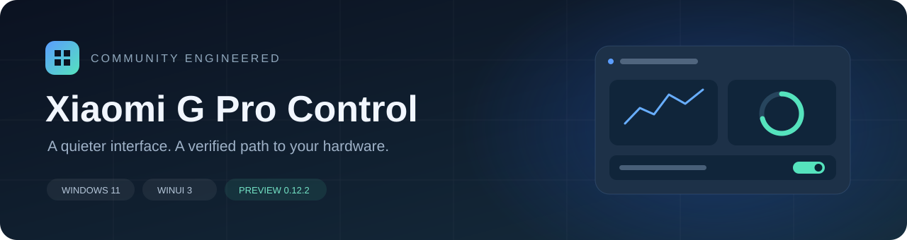
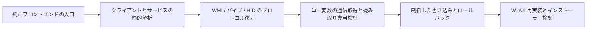

<div align="center">

[English](README.md) · [简体中文](README.zh-CN.md) · **日本語**



# XiaomiGProControl

**Redmi G Pro 2024 向けに再構築した、Windows 11 スタイルのコントロールセンター**

シンプルな画面、実機で検証したハードウェアプロトコル、追跡可能な解析記録。


[機能の状態](#機能の状態) · [使い始める](#使い始める) · [解析記録](docs/reverse-engineering.md) · [実装と構成](docs/implementation.md) · [検証記録](docs/verification.md)

</div>

---

## プロジェクトについて

XiaomiGProControl は **Redmi G Pro 2024 / TM2211** 向けの非公式コントロールセンターです。
純正アプリ、バックグラウンドサービス、BIOS の ACPI/WMI、HID 通信の解析結果を基に、
C#、WinUI 3、Mica 背景で日常的な操作を再実装しています。プロトコルの分析、仮説の訂正、
検証方法も記録しています。

対応する純正サービスとドライバーが必要です。対象はこのノート PC 系列であり、
BIOS や EC ファームウェアを置き換えるものではありません。

## 機能の状態

| 機能 | 状態 | 実装内容 |
| --- | --- | --- |
| 4 段階の性能モード | 実機検証済み | 静音 / バランス / 高速 / フルスピード。書き込み後に読み戻して確認 |
| CPU 温度と 2 基のファン回転数 | 実機検証済み | 純正 EC `0x0900`、管理者権限での読み取り専用 WMI |
| GPU モニタリング | 実装済み | NVML による使用率、温度、電力、VRAM |
| CPU / メモリー / ディスク / ネットワーク | 実装済み | ローカル計測。テレメトリーは送信しません |
| ディスプレイのオーバードライブ | 実機検証済み | 純正サービスで実行し、対応する状態通知を確認 |
| Fn / Windows キーロック / タッチパッド | 実装・検証済み | ページに戻った際と書き込み後にファームウェアから状態を取得。Windows キーの往復切り替えとページ移動を検証 |
| GPU 出力モード | 実装済み | `0=ハイブリッド`、`1=単体 GPU 直結`。読み書きを確認し、再起動後に反映 |
| 通常のキーボード照明 | 実機検証済み | 9 種類のハードウェア効果と任意 RGB の照明。対応する配色、方向、明るさ、速度、長さを調整 |
| 画面 / 音声連動照明 | 実装・検証済み | メイン画面の平均色、またはシステム再生音量でキーボード全体の色を制御。純正のキー単位マッピングやスペクトル表示とは異なります |
| 起動時の設定復元 | 実装済み | 性能モードと保存済み照明を復元。Windows の完全再起動を含む検証は未完了 |
| 終了確認と通知領域アイコン | 実装済み | 終了 / バックグラウンド / キャンセル。選択を記憶でき、設定から変更可能 |
| Windows 起動時の自動実行 | 実装済み | 現在のユーザーのログオン時に管理者タスクで起動。バックグラウンド起動も選択可能 |
| WLAN 高速化 | 状態取得 | 純正の Xiaomi ルーター高速化状態を利用。強制切り替えは未実装 |
| 独自ファンカーブ / 固定 RPM | 未実装 | 安全に検証できる書き込みプロトコルが未確立 |
| キー単位の画像マッピング / 音声スペクトル / 本体照明 | 未実装 | 現在の画面・音声連動はキーボード全体を同じ色で制御し、純正の全表現は再現していません |

「実機検証済み」は記録した機体とソフトウェアの組み合わせに限ります。
すべての構成への対応を保証するものではありません。範囲は [検証記録](docs/verification.md) を参照してください。

## 画面と操作

- Windows 11 の Mica、角丸カード、コンパクトなナビゲーション、ライト / ダークテーマ。
- 概要、性能、照明、デバイス、設定の 5 ページ。
- 主ページの切り替え時はサイドバーも同期し、戻る操作は明示的な下位ページだけに表示。
- デバイスと性能ページで GPU 制御を共有し、保存済みファームウェア値と再起動の案内を表示。
- 照明の変更前に元の状態を保存し、書き込み後に検証。失敗時は元に戻します。
- 適用に成功した照明設定を記憶し、起動時の復元は個別に無効化可能。
- 照明は 12 モード。画面・音声連動を停止、またはアプリを終了すると、以前の通常効果に戻ります。アニメーションの各フレームはキーボードのフラッシュに保存しません。
- ウィンドウを閉じる際に終了かバックグラウンド動作を選択。選択の記憶と再確認の設定も可能。
- 通知領域のアイコンをクリックすると復帰し、右クリックから終了できます。インストール済みランチャーを再度開いてもウィンドウが復帰します。
- 自動起動の無効化とログオン時のバックグラウンド起動を設定可能。手動起動では主画面を表示します。

## 使い始める

### 動作条件

| 項目 | 検証した構成 |
| --- | --- |
| OS | Windows 11 x64 |
| デバイス | Redmi G Pro 2024、マザーボード `TM2211` |
| 純正コントロールセンター | `2.1.1.418` |
| 純正サービス | `MiDeviceService 4.1.1.640` |
| RGB キーボード | `VID_1A86 / PID_E302 / MI_02`、ハードウェア `01.13` |
| 権限 | EC/WMI アクセスには管理者権限が必要 |

### インストール

現在のインストーラー出力は `GProControl-0.12.2-Setup-x64.exe` です。英語・中国語の Inno Setup
ウィザードに .NET と Windows App SDK ランタイムを同梱しています。バイナリは Git 履歴には
含めず、このリポジトリではまだ Release を公開していません。

完了後にアプリを起動するか選択できます。既定では起動しません。
対話形式の上書きアップグレードでも、完了後に起動するか確認します。

インストーラーの外側の起動プログラムとアプリのランチャーは、展開前に管理者権限を要求します。
ログオン時の自動起動には現在のユーザーの最上位権限タスクを使うため、ショートカットの
「管理者として実行」を手動で設定する必要はありません。

インストール先の直下にはランチャーを置き、DLL、言語、画面リソースは分類して保存します。
インストール時に WinUI 互換の実行キャッシュを準備し、アンインストール時は対応するキャッシュを
削除してユーザー設定を保持します。[インストーラーと配置](docs/installer-layout.md) を参照してください。

アップグレードは既存のインストール先を使用し、プログラムを自動更新します。所有ファイルの一覧を
比較して不要になった旧ファイルを削除し、ユーザー設定と一覧にない追加ファイルは保持します。
結果は [検証記録](docs/verification.md) に記載しています。

### ソースからビルド

Windows、.NET 10 SDK、対応する Windows SDK が必要です。

```powershell
dotnet restore GProControl/GProControl.csproj -p:Platform=x64
dotnet build GProControl/GProControl.csproj -c Release -p:Platform=x64 --no-restore
```

出力先：`GProControl/bin/x64/Release/net10.0-windows10.0.19041.0/`。
開発用出力では WinUI 本来の配置を維持し、インストーラーでは分類した配置を使います。

### オフラインテスト

```powershell
dotnet run --project tests/GProControl.ProtocolSmokeTests -c Release
dotnet run --project tests/GProControl.HardwareLogTests -c Release
```

この 2 つはハードウェアに書き込まず、プロトコルの境界、列挙値、ログの増分読み取り、設定保存を
検証します。`HardwareSmokeTests` や `LightingProbe` は実機へのアクセスや書き込みを行う場合が
あります。使用前に [テストの区分](docs/verification.md) を確認してください。
CI はビルドとオフラインテストだけを実行します。

## リバースエンジニアリングの流れ



解析では誤った仮説も訂正しました。WMI プロキシはコマンド種別 3 を使わず、性能モードには
3 系統の列挙値があります。また、照明 CMD 12 はキーボードの編集モードではありません。
経緯は [解析記録](docs/reverse-engineering.md) に残し、今後の調査で再利用できるようにしています。

## プロジェクト構成

```text
XiaomiGProControl/
├─ GProControl/                  WinUI 3 アプリ
│  ├─ Models/                    状態と設定モデル
│  ├─ Protocol/                  プロトコルのコーデックと列挙値
│  ├─ Services/                  純正サービス連携、HID、計測、設定、起動時復元
│  ├─ Views/                     ページと共通 GPU コントロール
│  └─ Assets/                    アプリアイコン
├─ tests/                        オフラインテスト、読み取り専用・実機検証ツール
├─ scripts/                      ビルド、パッケージ、通信取得、Ghidra スクリプト
├─ packaging/                    Inno Setup とネイティブランチャー
├─ tools/                        独自アイコン生成・オフラインファームウェア展開ツール
├─ docs/                         解析と実装の文書
└─ .github/                      CI と Issue テンプレート
```

`.analysis*`、`analysis-*`、`.tools`、`bin`、`obj`、`artifacts` にあるローカルの解析入力、
逆コンパイル出力、第三者のバイナリ、ビルド成果物はソース配布に含めません。

## ドキュメント

README は英語・簡体字中国語・日本語で提供しています。下記の詳細文書は、各リンク先の
原文で読めます。

| 文書 | 内容 |
| --- | --- |
| [解析記録](docs/reverse-engineering.md) | 方法、証拠、重要な訂正、プロトコルの発見 |
| [実装とアーキテクチャ](docs/implementation.md) | モジュール境界、構成、データフロー、パッケージ |
| [検証記録](docs/verification.md) | 検証済みの動作、未完了項目、テスト方法 |
| [サービスパイプのプロトコル](docs/service-pipe-protocol.md) | GameBox、WMI、列挙値、読み戻し、タイミング |
| [キーボード照明の解析](docs/lighting-hid-analysis.md) | 65 バイト HID、フィールドの通信取得、ロールバック |
| [BIOS の静的解析](docs/bios-analysis.md) | ファームウェア識別、ACPI/WMI、更新範囲 |
| [照明の通信取得ガイド](docs/lighting-capture-guide.md) | 単一変数での実験方法 |
| [インストーラーと配置](docs/installer-layout.md) | 分類配置、キャッシュ、ビルド、アンインストール |

## 開発と今後の予定

今後は完全再起動後の復元検証、照明と 4 ゾーン RGB の追加調査、本体照明、WLAN 状態の調査を
進めます。独自ファンカーブには新たなプロトコルの証拠が必要で、性能モードの列挙値から
直接導けるものではありません。

貢献と不具合報告は [CONTRIBUTING.md](CONTRIBUTING.md) を参照してください。
識別情報を除いた最小限のログを共有し、純正プログラム、BIOS、認証情報、ローカルログ全体は
アップロードしないでください。

## 注意事項

独立開発の非公式プロジェクトであり、Xiaomi、Redmi、Microsoft、NVIDIA との提携や承認は
ありません。名称と商標は各権利者に帰属します。独自の実装、分析方法、調査結果を収録し、
純正コントロールセンター、ドライバー、BIOS は配布しません。Windows App SDK と .NET は
それぞれのパッケージから復元します。

現在のリポジトリは非公開で、オープンソースライセンスは指定していません。
ソースのアップロードは公開再配布の許諾を意味しません。
