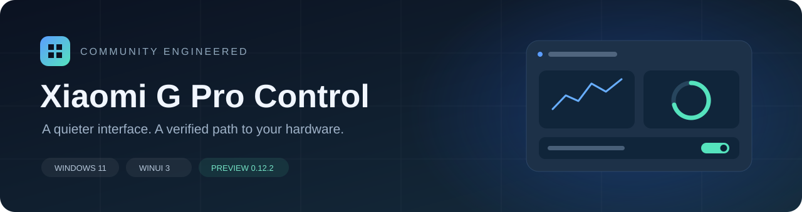
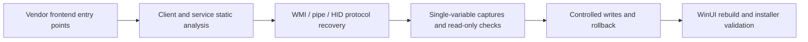

<div align="center">

**English** · [简体中文](README.zh-CN.md) · [日本語](README.ja.md) · [Deutsch](README.de.md) · [Русский](README.ru.md)



# XiaomiGProControl

**A Windows 11-style control center rebuilt for the Redmi G Pro 2024**

A clean interface, validated hardware protocols, and documented reverse engineering.


[Feature status](#feature-status) · [Getting started](#getting-started) · [Reverse engineering](docs/reverse-engineering.md) · [Architecture](docs/implementation.md) · [Validation](docs/verification.md)

</div>

---

## About

XiaomiGProControl is an unofficial control center rebuild for the **Redmi G Pro 2024 / TM2211**.
It uses evidence from the original application, background service, BIOS ACPI/WMI, and HID traffic
to reimplement common controls with C#, WinUI 3, and a Mica backdrop. The repository also records
protocol analysis, corrected assumptions, and validation methods.

It requires compatible vendor services and drivers. Its supported scope is this laptop family;
it does not replace BIOS or EC firmware.

## Feature status


- Factory preset cards with original defaults, seven solid colors, three gradient palettes, and reset-to-default controls.

| Feature | Status | Implementation |
| --- | --- | --- |
| Four performance presets | Validated on hardware | Quiet / Balanced / Turbo / Full Speed; readback after writes |
| CPU temperature and two fan speeds | Validated on hardware | Vendor EC `0x0900`, administrator-only WMI reads |
| GPU telemetry | Implemented | NVML utilization, temperature, power, and VRAM |
| CPU / memory / disk / network monitoring | Implemented | Local sampling; no telemetry uploads |
| Display overdrive | Validated on hardware | Vendor service operation with correlated status notifications |
| Fn / Windows key lock / touchpad | Implemented and validated | Firmware state is read when returning to the page and after writes; Windows key round-trip and navigation checks passed |
| GPU output mode | Implemented | `0=hybrid`, `1=discrete GPU`; read/write confirmation, reboot required |
| Standard keyboard lighting | Validated on hardware | Nine hardware effects and custom RGB lighting; applicable palette, direction, brightness, speed, and length controls |
| Screen / audio lighting | Implemented and validated | Primary-screen average color or system playback level drives uniform keyboard color while the app runs; differs from vendor per-key mapping and spectrum effects |
| Startup restoration | Implemented | Performance mode and saved keyboard lighting; full reboot validation remains pending |
| Close prompt and system tray | Implemented | Exit / run in background / cancel; optional remembered choice, editable in Settings |
| Start with Windows | Implemented | Elevated task at current-user logon; optional background startup |
| WLAN acceleration | Status reading | Uses the vendor Xiaomi router acceleration status; no forced toggle |
| Custom fan curves / fixed RPM | Not implemented | A safely verifiable write protocol has not been established |
| Per-key image mapping / audio spectrum / chassis lighting | Not implemented | Current screen and audio effects use uniform keyboard color; the vendor's full visuals are not reproduced |

Hardware validation applies to the recorded machine and software versions. It does not establish
compatibility with every configuration. See the [validation record](docs/verification.md) for the boundaries.

## Interface and behavior

- Windows 11 Mica, rounded cards, compact navigation, and light/dark themes.
- Overview, Performance, Lighting, Device, and Settings pages.
- Main-page navigation keeps the sidebar in sync; back navigation is reserved for explicit subpages.
- Device and Performance share a GPU mode control showing the saved firmware value and reboot notice.
- Lighting writes back up the original state, verify changes, and restore the backup on failure.
- Successfully applied lighting settings are remembered; startup restoration can be disabled separately.
- Twelve lighting modes; stopping a screen/audio effect or exiting restores the previous standard effect. Animation frames are not committed to keyboard flash.
- Closing the window offers exit or background operation. The choice can be remembered and reset in Settings.
- Click the tray icon to restore the window, or use its context menu to exit. Opening the installed launcher again also restores the window.
- Settings can disable logon startup or enable background startup. Manual launches show the main window.

## Getting started

### Requirements

| Item | Validated configuration |
| --- | --- |
| Operating system | Windows 11 x64 |
| Device | Redmi G Pro 2024, motherboard `TM2211` |
| Vendor control center | `2.1.1.418` |
| Vendor service | `MiDeviceService 4.1.1.640` |
| RGB keyboard | `VID_1A86 / PID_E302 / MI_02`, hardware version `01.13` |
| Permissions | Administrator privileges for EC/WMI access |

### Installation

Download `GProControl-0.12.3-Setup-x64.exe` from the
[v0.12.3 prerelease](https://github.com/Memories-white/XiaomiGProControl/releases/tag/v0.12.3).
Its English/Chinese Inno Setup wizard bundles the .NET and Windows App SDK runtimes.
Installer binaries are distributed as release assets and excluded from Git source history.

You can choose whether to launch the application after installation; the default is not to launch.
An interactive upgrade also offers this choice when it finishes.

The outer installer and application launcher request administrator privileges before extraction.
Logon startup uses a highest-privilege task for the current user, so no manual shortcut setting is needed.

The install root contains the launcher, with DLLs, languages, and UI resources grouped in subdirectories.
Installation prepares a WinUI-compatible runtime cache. Uninstallation removes the matching cache and
preserves user settings. See [installer layout](docs/installer-layout.md).

Upgrades reuse the existing directory, replace application files automatically, and remove retired files
from the owned-file inventory. User settings and unlisted extra files are preserved. Results are recorded
in the [validation document](docs/verification.md).

### Build from source

Requires Windows, the .NET 10 SDK, and the corresponding Windows SDK.

```powershell
dotnet restore GProControl/GProControl.csproj -p:Platform=x64
dotnet build GProControl/GProControl.csproj -c Release -p:Platform=x64 --no-restore
```

Output: `GProControl/bin/x64/Release/net10.0-windows10.0.19041.0/`.
Development outputs keep the native WinUI layout; the grouped layout is used for the installer.

### Offline tests

```powershell
dotnet run --project tests/GProControl.ProtocolSmokeTests -c Release
dotnet run --project tests/GProControl.HardwareLogTests -c Release
```

These two suites do not write to hardware. They cover protocol boundaries, enums, incremental logs,
and settings persistence. Tools named `HardwareSmokeTests` or `LightingProbe` can access or write to
real hardware; read the [test tiers](docs/verification.md) before using them.
CI builds the application and runs only the offline suites.

## Reverse engineering workflow



The research corrected several assumptions: the WMI proxy does not use command type 3; performance
modes have three separate enum mappings; lighting CMD 12 is not keyboard edit mode. These findings
are documented in the [reverse engineering notes](docs/reverse-engineering.md) to support future work.

## Project structure

```text
XiaomiGProControl/
├─ GProControl/                  WinUI 3 application
│  ├─ Models/                    State and settings models
│  ├─ Protocol/                  Protocol codecs and enums
│  ├─ Services/                  Vendor bridge, HID, telemetry, settings, startup restoration
│  ├─ Views/                     Pages and shared GPU controls
│  └─ Assets/                    Application icons
├─ tests/                        Offline tests, read-only probes, controlled hardware tools
├─ scripts/                      Build, packaging, capture, and Ghidra scripts
├─ packaging/                    Inno Setup installer and native launchers
├─ tools/                        Project-owned icon generator and offline firmware unpacker
├─ docs/                         Research and implementation documents
└─ .github/                      CI and issue templates
```

Local research inputs, decompilation outputs, third-party binaries, and build artifacts under
`.analysis*`, `analysis-*`, `.tools`, `bin`, `obj`, and `artifacts` are excluded from source distribution.

## Documentation

The README is available in English, Simplified Chinese, Japanese, German, and Russian. The detailed research and
implementation documents below retain their original Chinese or English text.

| Document | Contents |
| --- | --- |
| [Reverse engineering](docs/reverse-engineering.md) | Methods, evidence, corrections, and protocol discoveries |
| [Implementation and architecture](docs/implementation.md) | Module boundaries, structure, data flow, and packaging |
| [Validation](docs/verification.md) | Verified behavior, pending work, and test methods |
| [Service pipe protocol](docs/service-pipe-protocol.md) | GameBox, WMI, enums, readback, and timing |
| [Keyboard lighting analysis](docs/lighting-hid-analysis.md) | 65-byte HID frames, field captures, and rollback |
| [BIOS static analysis](docs/bios-analysis.md) | Firmware package identification, ACPI/WMI, and update scope |
| [Lighting capture guide](docs/lighting-capture-guide.md) | Single-variable experiments |
| [Installer and layout](docs/installer-layout.md) | Grouped files, runtime cache, build, and uninstallation |

## Development and next steps

Planned work includes full reboot restoration validation, further lighting and four-zone RGB research,
chassis lighting, and WLAN status. Custom fan curves require new protocol evidence; they cannot be
inferred directly from performance-mode enums.

See [CONTRIBUTING.md](CONTRIBUTING.md) for contributions and issue reports. Share minimal, sanitized
log excerpts. Do not upload vendor applications, BIOS images, account credentials, or complete local logs.

## Notice

This is an independent, unofficial project with no affiliation with or endorsement from Xiaomi, Redmi,
Microsoft, or NVIDIA. Names and trademarks belong to their respective owners. The repository contains
original implementation code, analysis methods, and findings; it does not distribute the vendor control
center, drivers, or BIOS firmware. Windows App SDK and .NET are restored through their respective packages.

No open-source license has been specified. Public access to the source code alone does not grant
permission for redistribution.
