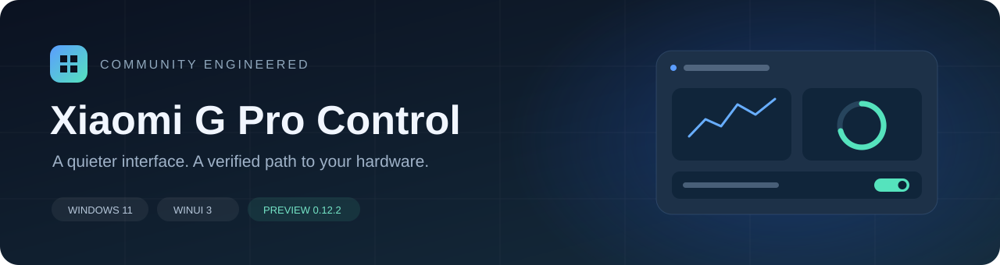
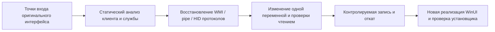

<div align="center">

[English](README.md) · [简体中文](README.zh-CN.md) · [日本語](README.ja.md) · [Deutsch](README.de.md) · **Русский**



# XiaomiGProControl

**Заново разработанный центр управления в стиле Windows 11 для Redmi G Pro 2024**

Простой интерфейс, проверенные аппаратные протоколы и документированный процесс обратной разработки.


[Состояние функций](#состояние-функций) · [Начало работы](#начало-работы) · [Обратная разработка](docs/reverse-engineering.md) · [Архитектура](docs/implementation.md) · [Проверки](docs/verification.md)

</div>

---


## О проекте

XiaomiGProControl — неофициальная новая реализация центра управления для **Redmi G Pro 2024 / TM2211**.
Она опирается на результаты изучения оригинального приложения, фоновой службы, ACPI/WMI в BIOS
и обмена по HID. Основные функции реализованы на C# и WinUI 3 с фоном Mica. В репозитории также
сохранены анализ протоколов, исправления ошибочных предположений и методы проверки.

Необходимы совместимые службы и драйверы производителя. Поддержка ограничена этим семейством
ноутбуков; приложение не заменяет прошивку BIOS или EC.

## Состояние функций

- Карточки заводских эффектов с исходными параметрами, семь однотонных цветов, три градиента и сброс параметров.

| Функция | Состояние | Реализация |
| --- | --- | --- |
| Подробные характеристики | Реализовано и проверено | CPU/GPU/ОЗУ/диски/экраны/BIOS/Windows; отчёт без серийного номера устройства |
| Мои сервисы | Реализовано | Официальные инструкции, условия обслуживания, сервисные центры, поддержка, драйверы и аккаунт; локальная диагностика |
| Четыре профиля производительности | Проверено на устройстве | Тихий / Сбалансированный / Турбо / Полная мощность; чтение состояния после записи |
| Температура CPU и обороты двух вентиляторов | Проверено на устройстве | EC производителя `0x0900`, чтение через WMI с правами администратора |
| Показатели GPU | Реализовано | NVML: загрузка, температура, мощность и видеопамять |
| CPU / память / диски / сеть | Реализовано | Локальные измерения без отправки телеметрии |
| Ускорение отклика экрана | Проверено на устройстве | Выполнение через службу производителя и сопоставление уведомлений о состоянии |
| Fn / блокировка Windows / тачпад | Реализовано и проверено | Чтение состояния из прошивки при возвращении на страницу и после записи; проверены переключение Windows туда и обратно и сохранение состояния при навигации |
| Режим вывода GPU | Реализовано | `0=гибридный`, `1=прямой вывод с дискретного GPU`; подтверждение чтения и записи, применение после перезагрузки |
| Обычная подсветка клавиатуры | Проверено на устройстве | Девять аппаратных эффектов и произвольный RGB; доступные для эффекта палитра, направление, яркость, скорость и длина |
| Подсветка по экрану / звуку | Реализовано и проверено | Средний цвет экрана, воспроизведение/микрофон, 17 полос спектра и четыре градиента; после проверки доступен поклавишный вывод |
| Восстановление при запуске | Реализовано | Профиль производительности и сохранённая подсветка; проверка после полной перезагрузки Windows ещё не завершена |
| Подтверждение закрытия и системный трей | Реализовано | Выход / работа в фоне / отмена; выбор можно запомнить и изменить в настройках |
| Запуск вместе с Windows | Реализовано | Задача с повышенными правами при входе текущего пользователя; возможен запуск в фоне |
| Ускорение WLAN | Чтение состояния | Используется состояние ускорения роутера Xiaomi через службу производителя; принудительное переключение не реализовано |
| Свои кривые вентиляторов / фиксированные RPM | Не реализовано | Безопасно проверяемый протокол записи ещё не установлен |
| Экран по клавишам / спектр на клавиатуре | Реализовано; нужна визуальная проверка | Матрица 7×17, четыре направления и палитры; включение после проверки с восстановлением |

Проверки относятся к зафиксированному устройству и версиям ПО. Они не подтверждают совместимость
со всеми конфигурациями. Подробности — в [журнале проверок](docs/verification.md).

## Интерфейс и поведение

- Mica в стиле Windows 11, скруглённые карточки, компактная навигация, светлая и тёмная темы.
- Страницы обзора, производительности, подсветки, устройств и настроек.
- При переходе между основными страницами боковая панель обновляется синхронно; возврат предусмотрен только для явно открытых вложенных страниц.
- Страницы устройств и производительности используют общий компонент GPU с сохранённым значением прошивки и напоминанием о перезагрузке.
- Перед записью подсветки сохраняется исходное состояние, результат проверяется, а при ошибке выполняется восстановление.
- Успешно применённые настройки подсветки запоминаются; восстановление при запуске можно отключить отдельно.
- Двенадцать режимов подсветки. Остановка экранного/звукового эффекта или выход восстанавливают предыдущий обычный эффект. Кадры анимации не записываются во флеш-память клавиатуры.
- При закрытии окна можно выйти или оставить приложение в фоне. Выбор можно запомнить и сбросить в настройках.
- Щелчок по значку в трее возвращает окно, контекстное меню позволяет выйти. Повторный запуск установленного лаунчера также возвращает окно.
- Автозапуск можно отключить или настроить запуск в фоне. При ручном запуске открывается главное окно.

## Начало работы

### Требования

| Параметр | Проверенная конфигурация |
| --- | --- |
| ОС | Windows 11 x64 |
| Устройство | Redmi G Pro 2024, системная плата `TM2211` |
| Оригинальный центр управления | `2.1.1.418` |
| Служба производителя | `MiDeviceService 4.1.1.640` |
| RGB-клавиатура | `VID_1A86 / PID_E302 / MI_02`, версия оборудования `01.13` |
| Права | Для EC/WMI нужны права администратора |

### Установка

Текущая предварительная сборка — `GProControl-0.13.0-Setup-x64.exe`, доступная в
[предварительном выпуске v0.13.0](https://github.com/Memories-white/XiaomiGProControl/releases/tag/v0.13.0).
Английский/китайский мастер Inno Setup включает среды выполнения .NET и Windows App SDK.
Установщики публикуются как вложения выпуска и не сохраняются в истории исходного кода Git.

После установки можно выбрать, запускать ли приложение; по умолчанию оно не запускается.
При интерактивном обновлении этот выбор также предлагается после завершения.

Внешняя программа установки и лаунчер запрашивают права администратора до распаковки.
Для автозапуска используется задача с наивысшими правами при входе текущего пользователя;
вручную менять свойства ярлыка не требуется.

В корне установки находится лаунчер, а DLL, языковые файлы и ресурсы интерфейса распределены по
подкаталогам. При установке создаётся совместимый с WinUI кеш выполнения. Удаление очищает
соответствующий кеш и сохраняет пользовательские настройки. См. [структуру установщика](docs/installer-layout.md).

Обновление использует существующий каталог, автоматически заменяет файлы программы и удаляет
устаревшие файлы по списку принадлежащих установщику файлов. Настройки и дополнительные файлы,
не включённые в список, сохраняются. Результаты приведены в [журнале проверок](docs/verification.md).

### Сборка из исходников

Нужны Windows, .NET 10 SDK и соответствующий Windows SDK.

```powershell
dotnet restore GProControl/GProControl.csproj -p:Platform=x64
dotnet build GProControl/GProControl.csproj -c Release -p:Platform=x64 --no-restore
```

Результат: `GProControl/bin/x64/Release/net10.0-windows10.0.19041.0/`.
Сборки для разработки сохраняют стандартную структуру WinUI; установщик использует сгруппированное размещение.

### Офлайн-тесты

```powershell
dotnet run --project tests/GProControl.ProtocolSmokeTests -c Release
dotnet run --project tests/GProControl.HardwareLogTests -c Release
```

Эти два набора не записывают данные в оборудование. Они проверяют границы протоколов, перечисления,
добавленные записи журналов и сохранение настроек. Инструменты `HardwareSmokeTests` и `LightingProbe`
могут обращаться к реальному оборудованию и выполнять запись. Перед использованием прочитайте
[описание уровней тестирования](docs/verification.md). CI собирает приложение и запускает только офлайн-тесты.

## Процесс обратной разработки



Исследование исправило ряд предположений: WMI-прокси не использует тип команды 3; профили
производительности имеют три отдельных набора значений; команда подсветки CMD 12 не означает
режим редактирования клавиатуры. Выводы сохранены в [документации по обратной разработке](docs/reverse-engineering.md).

## Структура проекта

```text
XiaomiGProControl/
├─ GProControl/                  Приложение WinUI 3
│  ├─ Models/                    Модели состояния и настроек
│  ├─ Protocol/                  Кодеки протоколов и перечисления
│  ├─ Services/                  Связь со службой, HID, измерения, настройки, восстановление
│  ├─ Views/                     Страницы и общие элементы управления GPU
│  └─ Assets/                    Значки приложения
├─ tests/                        Офлайн-тесты, проверки чтением и контролируемые аппаратные тесты
├─ scripts/                      Сборка, упаковка, захват обмена и скрипты Ghidra
├─ packaging/                    Inno Setup и нативные лаунчеры
├─ tools/                        Собственные инструменты значков и офлайн-распаковки прошивки
├─ docs/                         Документация исследования и реализации
└─ .github/                      CI и шаблоны обращений
```

Локальные входные данные исследования, результаты декомпиляции, сторонние бинарные файлы и
результаты сборок в `.analysis*`, `analysis-*`, `.tools`, `bin`, `obj` и `artifacts` не распространяются
в составе исходного кода.

## Документация

README доступен на английском, упрощённом китайском, японском, немецком и русском языках.
Подробные документы ниже сохраняют исходный китайский или английский текст.

| Документ | Содержание |
| --- | --- |
| [Обратная разработка](docs/reverse-engineering.md) | Методы, доказательства, исправления и найденные протоколы |
| [Реализация и архитектура](docs/implementation.md) | Границы модулей, структура, потоки данных и упаковка |
| [Проверки](docs/verification.md) | Проверенное поведение, незавершённые пункты и методы тестирования |
| [Протокол канала службы](docs/service-pipe-protocol.md) | GameBox, WMI, перечисления, чтение результата и синхронизация |
| [Анализ подсветки клавиатуры](docs/lighting-hid-analysis.md) | HID-пакеты по 65 байт, поля и откат |
| [Статический анализ BIOS](docs/bios-analysis.md) | Определение пакета прошивки, ACPI/WMI и область обновления |
| [Руководство по захвату подсветки](docs/lighting-capture-guide.md) | Эксперименты с изменением одной переменной |
| [Установщик и размещение](docs/installer-layout.md) | Группировка файлов, кеш, сборка и удаление |

## Разработка и дальнейшие планы

Планируются полная проверка восстановления после перезагрузки, дальнейшее изучение подсветки и
четырёхзонного RGB, подсветка корпуса и состояние WLAN. Для собственных кривых вентиляторов нужны
новые данные о протоколе; их нельзя напрямую вывести из перечислений профилей производительности.

Правила участия и сообщений об ошибках — в [CONTRIBUTING.md](CONTRIBUTING.md). Передавайте только
минимальные обезличенные фрагменты журналов. Не загружайте оригинальные программы, BIOS,
учётные данные или полные локальные журналы.

## Примечание

Это независимый неофициальный проект, не связанный с Xiaomi, Redmi, Microsoft или NVIDIA и не
одобренный ими. Названия и товарные знаки принадлежат соответствующим владельцам. Репозиторий
содержит собственную реализацию, методы анализа и результаты исследования; оригинальный центр
управления, драйверы и BIOS не распространяются. Windows App SDK и .NET восстанавливаются из своих пакетов.

Лицензия открытого ПО пока не выбрана. Сам по себе публичный доступ к исходникам не даёт
разрешения на их дальнейшее распространение.
