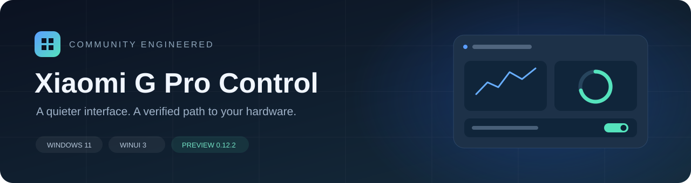

<div align="center">

[English](README.md) · **简体中文** · [日本語](README.ja.md) · [Deutsch](README.de.md) · [Русский](README.ru.md)



# XiaomiGProControl

**为 Redmi G Pro 2024 重构的 Windows 11 风格控制中心**

轻量的界面，经过验证的硬件协议，可追溯的逆向过程。


[功能状态](#功能状态) · [快速开始](#快速开始) · [逆向过程](docs/reverse-engineering.md) · [实现架构](docs/implementation.md) · [验证记录](docs/verification.md)

</div>

---


## 项目介绍

XiaomiGProControl 是针对 **Redmi G Pro 2024 / TM2211** 的非官方控制中心重构。
项目以原厂程序、后台服务、BIOS ACPI/WMI 与 HID 通信证据为基础，使用 C#、WinUI 3
和 Mica 背景重新实现常用功能，并保留协议分析、实验纠错和验证方法。

它依赖兼容的原厂服务与驱动，**不是通用游戏本控制工具，也不替代 BIOS/EC 固件**。

## 功能状态

- 原厂预设卡片与默认参数、7 种单色、3 组渐变配色，支持一键恢复当前效果默认参数。

| 功能 | 当前状态 | 实现说明 |
| --- | --- | --- |
| 详细参数 | 已实现并验证 | 本机 CPU/显卡/内存/磁盘/屏幕/BIOS/系统参数；报告排除设备序列号 |
| 我的服务 | 已实现 | 官方手册、售后政策、网点、客服、驱动及账号入口；本地诊断摘要 |
| 四档性能模式 | 已实机验证 | 静谧 / 均衡 / 极速 / 狂暴，写入后读回 |
| CPU 温度、双风扇转速 | 已实机验证 | 原厂 EC `0x0900`，管理员只读 WMI |
| GPU 遥测 | 已实现 | NVML：利用率、温度、功耗、显存 |
| CPU / 内存 / 磁盘 / 网络监控 | 已实现 | 本机采样，不上传遥测 |
| 屏幕加速 | 已实机验证 | 原厂服务执行，并关联状态通知 |
| Fn / Windows 键锁 / 触控板 | 已实现并验证 | 切回页面读取固件状态；写后读回，Windows 键锁往返与切页保持验证通过 |
| 显卡输出模式 | 已实现 | `0=混合输出`、`1=独显直连`，读写确认，重启生效 |
| 常规键盘灯效 | 已实机验证 | 9 种硬件效果及自选 RGB 柔光；支持适用的配色、方向、亮度、速度和长度 |
| 光影随行 / 光音视界 | 已实现并验证 | 主屏平均色；系统声音/麦克风、17 段频谱预览和四组渐变混色；键盘仍为统一 RGB |
| 启动恢复 | 已实现 | 性能模式；键盘灯配置保存/恢复，全重启验收仍待补齐 |
| 关闭询问与后台托盘 | 已实现 | 退出 / 转入后台 / 取消，可记住选择并在设置中修改 |
| 开机自启动 | 已实现 | 当前用户管理员登录任务，可选择启动后转入后台 |
| WLAN 加速 | 状态读取 | 复用原厂小米路由器加速状态，未实现强制开关 |
| 自定义风扇曲线 / 固定 RPM | 未实现 | 尚无可安全验证的写入协议 |
| 逐键图像映射 / 键盘频谱柱 / 机身灯 | 未实现 | 当前屏幕与声音联动使用整键盘颜色，未复刻原厂全部视觉细节 |

这里的“已实机验证”只代表记录中的目标机器和版本，不代表所有配置均兼容。
详细边界见 [验证记录](docs/verification.md)。

## 界面与交互

- Windows 11 Mica、圆角卡片、紧凑导航和深浅色主题。
- 概览、性能、灯效、设备、设置五个主要页面。
- 主页面跳转同步侧栏选中状态；返回仅用于明确的二级页面。
- 设备页与性能页复用显卡控制组件，显示固件保存值与重启提示。
- 灯效写入先备份、再校验，失败时恢复原状态。
- 键盘灯开关和参数在本程序内成功应用后记住，恢复功能可单独关闭。
- 灯效页提供 12 个模式；动态屏幕与声音联动停止或退出时恢复之前的常规效果，动画帧不写入键盘闪存。
- 关闭窗口时询问退出或转入后台；可勾选“不再询问”，也能在设置中重新开启。
- 后台点击通知区域图标恢复窗口，右键可退出；再次启动安装目录的程序也会恢复窗口。
- 设置页可关闭开机自启动，或选择登录后后台启动；手动启动仍显示主窗口。

## 快速开始

### 运行条件

| 项目 | 当前验证范围 |
| --- | --- |
| 操作系统 | Windows 11 x64 |
| 设备 | Redmi G Pro 2024，主板 `TM2211` |
| 原厂控制中心 | `2.1.1.418` |
| 原厂服务 | `MiDeviceService 4.1.1.640` |
| RGB 键盘 | `VID_1A86 / PID_E302 / MI_02`，硬件版本 `01.13` |
| 权限 | EC/WMI 访问需要管理员权限 |

### 安装

从 [v0.12.4 预发布页面](https://github.com/Memories-white/XiaomiGProControl/releases/tag/v0.12.4)
下载 `GProControl-0.12.4-Setup-x64.exe`。安装器采用中文/英文 Inno Setup 向导，包含 .NET
与 Windows App SDK 运行库。安装包通过 Release 附件分发，不存入 Git 源码历史。

安装结束后可选择是否启动，默认不启动；覆盖升级结束后也会提供启动询问。

安装器最外层入口和启动器均声明管理员权限，双击在解压前自动请求 UAC 提升。开机自启动通过当前用户的
最高权限计划任务实现，不需要手工设置快捷方式的“以管理员身份运行”。

安装根目录只保留启动器；DLL、语言和界面资源分类存放。首次安装准备 WinUI 兼容
运行缓存，卸载清理本安装对应缓存并保留用户设置。详见 [安装目录与安装包](docs/installer-layout.md)。

0.12.4 安装器已加入沿用旧目录、自动覆盖升级和按清单清理废弃程序文件的逻辑，
用户设置与清单外文件保留；新版安装与升级验收结果见 [验证记录](docs/verification.md)。

### 从源码构建

需要 Windows、.NET 10 SDK 及对应 Windows SDK。

```powershell
dotnet restore GProControl/GProControl.csproj -p:Platform=x64
dotnet build GProControl/GProControl.csproj -c Release -p:Platform=x64 --no-restore
```

输出：`GProControl/bin/x64/Release/net10.0-windows10.0.19041.0/`。
调试构建目录保持 WinUI 原生布局，分类布局用于正式安装包。

### 离线测试

```powershell
dotnet run --project tests/GProControl.ProtocolSmokeTests -c Release
dotnet run --project tests/GProControl.HardwareLogTests -c Release
```

这两组不写硬件，覆盖协议边界、枚举、增量日志与配置保存。
带 `HardwareSmokeTests` 或 `LightingProbe` 名称的工具可能真实访问或写入硬件，
使用前应先阅读 [测试分层说明](docs/verification.md)。CI 只构建并执行离线测试。

## 逆向分析路线


研究过程中也纠正了错误假设：WMI 代理并不走命令类型 3；性能模式存在三套枚举；
灯效 CMD 12 并不是键盘编辑态。这些过程保留在 [逆向分析过程](docs/reverse-engineering.md)，
帮助后续研究避免重复走弯路。

## 项目目录

```text
XiaomiGProControl/
├─ GProControl/                  WinUI 3 主程序
│  ├─ Models/                    状态与配置模型
│  ├─ Protocol/                  纯协议编解码与枚举
│  ├─ Services/                  原厂桥、HID、遥测、设置与启动恢复
│  ├─ Views/                     页面及共享显卡控件
│  └─ Assets/                    应用图标
├─ tests/                        离线测试、只读探针及受控真机工具
├─ scripts/                      构建、打包、抓帧与 Ghidra 脚本
├─ packaging/                    Inno Setup 安装器与原生启动器
├─ tools/                        自有图标生成器和离线固件解包工具
├─ docs/                         研究与实现文档
└─ .github/                      CI 和问题模板
```

`.analysis*`、`analysis-*`、`.tools`、`bin`、`obj` 和 `artifacts` 中的本机研究输入、
反编译输出、第三方二进制及构建产物均不随源码发布。

## 文档导航

README 提供英文、简体中文、日文、德语和俄语版本。下方详细研究与实现文档保留各自的中文或英文原文。

| 文档 | 内容 |
| --- | --- |
| [逆向过程](docs/reverse-engineering.md) | 方法、证据链、关键纠错与协议发现 |
| [实现过程与架构](docs/implementation.md) | 模块边界、目录结构、数据流和打包 |
| [验证记录](docs/verification.md) | 已验证内容、未完成项与测试方法 |
| [服务管道协议](docs/service-pipe-protocol.md) | GameBox、WMI、枚举、读回和时序 |
| [键盘灯效分析](docs/lighting-hid-analysis.md) | 65 字节 HID、字段抓帧与回滚 |
| [BIOS 静态分析](docs/bios-analysis.md) | 固件包识别、ACPI/WMI 与更新范围 |
| [灯效抓帧指南](docs/lighting-capture-guide.md) | 单变量实验的操作方法 |
| [安装包与目录](docs/installer-layout.md) | 分类布局、缓存、构建与卸载 |

## 开发与后续计划

近期方向是补齐完整重启恢复验收、更多灯效和四区 RGB，再研究机身灯与 WLAN 状态。
自定义风扇曲线需要新的协议证据，不能由性能模式枚举直接推导。

贡献与问题反馈见 [CONTRIBUTING.md](CONTRIBUTING.md)。请提交去标识化的最小日志片段，
不要上传原厂程序、BIOS、账号凭据或完整本机日志。

## 声明

这是独立开发的非官方项目，与 Xiaomi、Redmi、Microsoft、NVIDIA 没有隶属或背书关系。
相关名称和商标属于各自所有者。仓库包含自有实现、分析方法和研究结论，不分发原厂
控制中心、驱动或 BIOS 固件。Windows App SDK 和 .NET 通过各自的软件包恢复。

项目尚未指定开源许可；公开浏览源码不等于授予再分发许可。
