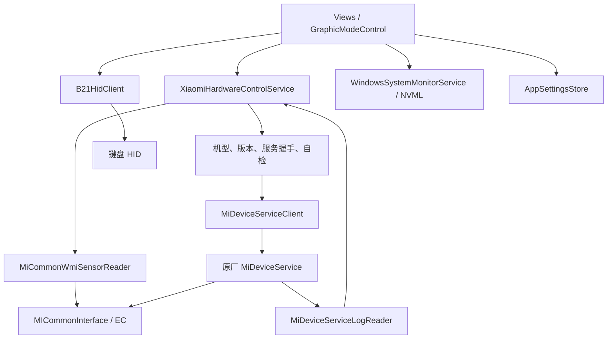

# 实现过程与架构

## 设计目标

重构围绕三件事组织：WinUI 界面负责表达意图，服务层负责验证与串行控制，协议层
只处理字节和枚举。无法确认的状态不显示成成功，未标定的参数不开放为可写选项。

## 数据流



## 模块职责

主窗口通过 `NavigateTo(tag)` 统一处理跨页面跳转。Frame 完成导航后同步侧栏和后退状态，
页面快捷入口不自行维护侧栏选中项。主菜单和“查看模式”属于主页面跳转，会清除返回历史；
只有显式 `asSubpage: true` 的二级入口保留返回历史，避免把主页面切换当成层级导航。

| 目录 / 组件 | 职责 |
| --- | --- |
| `Models/` | 监控快照、控制结果、灯效参数与设备状态 |
| `Protocol/` | 外层帧、GameBox、WMI 与 HID 编解码；不直接操作硬件 |
| `XiaomiHardwareControlService` | 白名单、模式映射、串行写入、状态确认 |
| `MiDeviceServiceClient` | 命名管道连接、注册、发送和响应窗口 |
| `MiDeviceServiceLogReader` | 游标增量读取与请求后的新记录匹配 |
| `MiCommonWmiSensorReader` | 管理员只读温度/风扇和显卡模式读取 |
| `B21HidClient` | 指定 RGB HID、版本检查、状态备份、写入、保存与回滚 |
| `AppSettingsStore` | JSON 配置和原子文件替换 |
| `StartupRegistrationService` | 可选管理员登录任务及安装器启动路径适配 |
| `TrayIconService` | Win32 通知区域图标、恢复窗口、退出菜单与 Explorer 重启后恢复图标 |
| `GraphicModeControl` | 设备/性能页共享显卡读写与重启提示 |
| `StartupDiagnostics` | 本地启动故障诊断，不上传 |

`B21HidClient` 当前文件名仍为 `B21HidReadOnlyClient.cs`，是从只读探针演进而来的历史命名。

## 迭代过程

### 界面骨架与只读监控

先建立概览、性能、灯效、设备和设置页面，再加入 Windows 本机统计与 NVIDIA NVML。
缺失指标使用空值占位，不把“读不到”显示成 0。

### 性能模式与服务控制

恢复管道信封和 protobuf 风格字段后，区分服务模式与 EC 模式，加入写前读取和写后确认。
增量日志包含时间门槛；读取管道对象存在性后，还要实际连接并注册。

### 自动自检与设备开关

启动等待服务就绪，调用共享的 `EnsureWmiTransportAsync`。并发页面复用同一任务，
后续请求复用结果；失败时设备页允许手动重新自检。自检只查询，不切换设备。

Windows 键的界面语义为“打开＝锁定”。它与 Fn/触控板的用户意图不同，因此需要明确映射。

### 灯效与恢复

将已标定参数建模成 `WaveLightingProfile`，在入口验证允许值。开关前保留波浪配置，
成功写入后保存开关状态。页面与启动恢复共用进程内 HID 锁，失败后重新读取状态再开放控件。

启动恢复仅接受已验证的机型、版本、HID 硬件和参数范围；不会自动覆盖其他未标定效果。

### 分类安装目录

WinUI 资源存在相对路径约束，因此采用原生启动器＋分类资源＋版本化运行缓存：

1. `dotnet publish` 生成 x64 自包含程序。
2. 根据 PE 的 CLR 头区分托管和原生 DLL。
3. 语言归入 `Languages`，DLL 归入 `Libraries`，其他资源归入 `Resources`。
4. 生成每个文件的原始相对路径、安装路径和 SHA-256 清单。
5. C++ 启动器校验并准备管理员可写的 ProgramData 缓存，恢复 WinUI 所需执行布局。
6. Inno Setup 生成中文/英文安装器，卸载保留用户设置。
7. 原生安装入口嵌入 Inno 输出，在解压前通过清单请求 UAC 提升，修复普通权限 Temp 拒绝访问。

完整目录见 [installer-layout.md](installer-layout.md)。

### 关闭行为与自启动

关闭窗口默认显示 WinUI 对话框，可退出、转入后台或取消；勾选“不再询问”后只在
实际选择退出或后台时保存偏好。设置页可随时改回每次询问。后台操作先注册托盘图标，
成功后才隐藏主窗口，避免留下无法找回的进程。再次运行安装目录启动器会唤回后台窗口。

开机启动使用当前用户登录触发的最高权限计划任务，支持电池供电。`--startup` 与
后台启动偏好同时满足时隐藏窗口；手动运行显示窗口。安装器与应用清单声明管理员权限。
安装验收的 `--package-smoke` 模式跳过硬件恢复与计划任务注册，仅验证窗口、托盘和运行布局。

## 构建与测试

```powershell
dotnet restore GProControl/GProControl.csproj -p:Platform=x64
dotnet build GProControl/GProControl.csproj -c Release -p:Platform=x64 --no-restore
dotnet run --project tests/GProControl.ProtocolSmokeTests -c Release
dotnet run --project tests/GProControl.HardwareLogTests -c Release
```

构建安装器还需要 MSVC x64、Windows SDK 与 Inno Setup 编译器。
`scripts/build-installer.ps1` 使用 `.tools/InnoSetup/ISCC.exe`，可用 `-InnoCompiler`
指定其他路径。简体中文翻译也需放入编译器的 `Languages/ChineseSimplified.isl`。

```powershell
pwsh -File scripts/build-installer.ps1 -InnoCompiler 'C:\Tools\InnoSetup\ISCC.exe'
```

## 目录说明

| 路径 | 是否进入 Git | 说明 |
| --- | --- | --- |
| `GProControl/` | 是 | 应用源代码、XAML 与自有图标 |
| `tests/` | 是 | 测试及探针源码 |
| `scripts/` | 是 | 自有构建和分析脚本 |
| `packaging/` | 是 | C++ 启动器、安装定义和说明 |
| `tools/` | 是 | 自有辅助工具源码 |
| `docs/` | 是 | 整理后的分析、实现与验证文档 |
| `.analysis*`、`analysis-*` | 否 | 原厂输入、固件、Ghidra 数据库和本机日志 |
| `.tools/` | 否 | 第三方分析工具与编译器 |
| `bin/`、`obj/`、`artifacts/` | 否 | 可重新生成的构建和打包产物 |

仓库不携带用户本机的 `HANDOFF.md`。公开阅读入口是 README 及本文档导航。

## 参数、服务与音频扩展

`HardwareDetailsService` 异步读取 WMI 参数并缓存，`DetailsPage` 提供序列号显隐及排除序列号的参数报告。
`SupportPage` 和 `SupportLinks` 管理官方服务入口、用户中心与本地诊断摘要，见 [服务与参数](service-and-details.md)。
`AudioSpectrumReader` 在独立 MTA 线程维护 WASAPI 采样，`AudioSpectrumDsp` 做 PCM 解码及 FFT；
`AmbientLightingOptions` 保存采集源、呈现方式、渐变和屏幕采样密度。动画仍通过已验证的统一 RGB 输出。

```powershell
dotnet run --project tests/GProControl.AudioSpectrumTests -c Release
dotnet run --project tests/GProControl.DetailsSmokeTests -c Release
```

默认离线测试不会播放或采集音频，也不会读取本机序列号。音频 `--tone` 是显式的真实播放采样验收。
