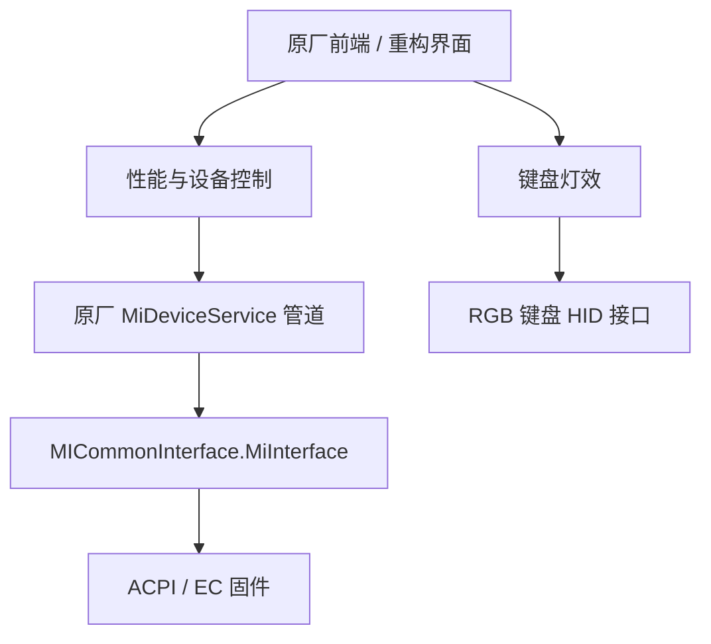

# 逆向分析过程

> 本文区分静态结论、真机观察和仍待验证的假设。研究输入由设备所有者提供，原厂二进制与固件不随仓库分发。

## 1. 目标与方法

目标是理解原控制中心提供的能力，并用 Windows 11 风格界面重新实现经过验证的部分。
研究对象包括客户端 `libXiaomiGCommandCenter.dll`、原厂后台
`MiDeviceServiceEntry.dll`、前端 JavaScript、设备日志和官方 BIOS 包。

工具包括 REA、Ghidra、UEFIExtract、ACPICA iASL，以及项目中的 C#/PowerShell 只读探针。
运行时证据只取与当前操作关联的新增记录，避免把旧日志误判为操作成功。

采用的证据顺序：

1. 从原厂界面动作追踪前端桥接方法。
2. 通过字符串、RTTI、虚表和交叉引用定位原生入口。
3. 对照构造器、序列化器和分发器恢复字段，而非仅凭函数名猜测。
4. 先发只读请求，确认目标设备、版本、实际执行及返回格式。
5. 对已确定字段做单变量实验。
6. 写入前备份、写入后读回；异常恢复原状态，再保存和复核。

## 2. 从界面走到硬件

原控制中心使用 CEF 前端。`set_performance_mode`、`set_graphic_mode` 等桥接方法
进入原生适配层；性能和设备开关继续委托原厂服务，键盘灯效则直接访问 HID。



这意味着“原厂服务能用”并不等于“灯效也能通过服务实现”。两条链路需要独立验证。

## 3. 服务管道：从错误载体到 GameBox

首先恢复了外层帧：帧类型、客户端标识长度、UTF-8 标识和命令体。
随后沿 `PipeServerHandler` 的分发逻辑检查各命令类型。

早期把类型 `3` 的 `ClientDataPipeCmd` 当成 WMI 入口，独立请求没有产生预期执行记录。
进一步检查动态类型和反序列化器后发现：它实际承载 `MiOSD::MiOSDEventInfo`。

真正的 WMI 代理位于 **GameBox，命令类型 1**：

| 字段 | 作用 |
| --- | --- |
| `business_type` | 业务标签，部分值被其他处理器占用 |
| `data` | 原始字节形式的 WMI 操作描述 |
| `status` | 操作类型；`0` 为执行 |

遗漏 `status` 会让请求无法走到正确操作路径。修复后，新增
`HandleExecBusiness info_detail ...` 记录确认服务执行了指定 32 字节 `InData`。

这一纠错也否定了早期“Boost 序列化”的猜测：实际恢复的是 protobuf 风格 TLV 字段。
完整布局、标签和示例见 [服务管道协议](service-pipe-protocol.md)。

## 4. 性能模式：三套枚举必须分开

“界面 setter”“服务内部模式”“EC 回读值”不是同一套编号。
将原厂前端值直接交给内部服务会出现模式错位。

当前实现明确记录服务值与 EC 值的对应关系：

| 模式 | 服务内部值 | EC 回读值 |
| --- | ---: | ---: |
| 静谧 | 0 | 2 |
| 均衡 | 1 | 1 |
| 极速 | 2 | 3 |
| 狂暴 | 3 | 4 |

这套映射在真机受控切换与恢复中验证，并由离线测试固定。

另一个问题是响应时序：类型 12 性能命令不通过管道返回预期结果，而是通过服务日志
和通知发布。原实现每条请求空等数秒，导致切换缓慢。改为短响应探测与增量日志读回后，
记录中的典型切换时间约为 0.3–0.7 秒；这不是对所有环境的性能保证。

## 5. BIOS：只分析更新包，不执行刷写器

离线分析 `RMGRP6B0P0909` 更新包，确认该包更新 BIOS 区而不包含 EC 固件更新。
通过 UEFI 模块中的 SSDT 与 `WMAA` 恢复 32 字节 WMI 输入结构：

| 偏移 | 长度 | 内容 |
| --- | ---: | --- |
| 0 | 2 | `0xFA00` 读取 / `0xFB00` 写入 |
| 2 | 2 | 功能组 |
| 4 | 2 | 选择器 / 模式值 |
| 6 | 4 | 参数值 |

功能组 `0x0800` 对应性能策略，`0x0900` 读取双风扇与温度，`0x0A00` 对应设备开关，
`0x0B00` 对应显卡输出模式。

初版把 `0x0900` 的返回字段顺序理解反了，范围检查因此拒绝了
`5297 / 5233 / 96 / 58`。与固件定义对照后，确认前两项为风扇 RPM，后两项为温度。
修复后读到 `4707 / 4568 RPM` 与 `90 / 56 °C`。

这是当时的采样值，不代表温控上限或性能测试结果。详见 [BIOS 分析](bios-analysis.md)。

## 6. 键盘灯效：65 字节 HID 与单变量实验

从 `LightEffectManager` 追到 `B21PayloadWriter::KeyBoard1ByteCmd`，确认键盘灯不经过
MiDeviceService。RGB 设备为 `VID_1A86 / PID_E302 / MI_02`，每帧固定 65 字节：

```text
00 57 AB <CMD> ...
```

第一次抓帧因五组操作使用同一标签，无法把字段变化对应到具体设置。第二轮每次只改
一项并使用不同标签，得到以下波浪状态布局：

| 偏移 | 字段 | 已确认值 |
| ---: | --- | --- |
| 5 | 效果 / 关闭标志 | `01=波浪`，`FF=关闭` |
| 6 | 配色索引 | `00=第1项`，`02=第3项` |
| 7 | 方向 | `01=方向2`，`00=方向4` |
| 8 | 亮度 | `00=1档`，`03=2档` |
| 9 | 速度 | `01=1档`，`03=3档` |
| 12 | 区域与开关 | 高半字节为区域；低半字节 `3=开`，`0=关` |

这里没有把两个已观察端点外推成全部中间档位。其他值仍然不开放。

进一步反编译确认使用共享读写 `CreateFileW`，通过 `WriteFile/ReadFile` 传输，
并按响应 CMD 匹配请求。CMD 6 返回本机硬件版本 `01.13`。

键盘编辑页的行为也经过纠错：CMD 0 是心跳，**CMD 12 并不是键盘编辑态**。
最小写入序列为：

```text
CMD 6 版本检查 → CMD 1 备份 → CMD 2 写入 → CMD 1 校验 → CMD 5 保存 → CMD 1 复核
```

完整波浪参数与开关均完成往返恢复。实测曾遇到首次恢复亮度未生效，因此回滚带三次
有限重试，每次都重新读回。详见 [灯效分析](lighting-hid-analysis.md)。

## 7. 显卡模式与读回

原厂前端枚举明确给出 `HybridMode=0`、`DirectMode=1`。重构界面因此使用
“混合输出 / 独显直连”，而不再展示没有说明的 0/1。

最新实现区分固件保存值与当前显示连接状态：模式写入后需要重启，不能仅凭返回值
宣称显示链路已经切换。切换前读取当前值，同一目标不重复写入，切换后再次读取确认。

## 8. 仍然未知的部分

- 自定义风扇曲线与固定 RPM 没有可靠写入/读回证据。
- 九种常规硬件效果、原厂单色/渐变与柔光已完成单项读回；全部参数笛卡尔组合尚未穷尽。
- 动态逐键矩阵的有效键掩码和物理映射仍待确认；音频 FFT 预览已实现，键盘输出仍为统一混色。
- 顶盖徽标灯与其他机身灯效仍待接入。
- WLAN 加速依赖原厂小米路由器路径，当前只展示服务状态。
- 完整 Windows 重启后的灯效恢复仍待专门验收。

## 9. 复现方式与材料边界

仓库提供 Ghidra Java 脚本、命令脚本、离线固件载荷解码器、HID/服务探针和协议测试。
原厂二进制、固件原文、数据库与完整日志不提交。
部分历史脚本保留初始 Ghidra 地址和本地 JDK/工具布局，需按自己的环境配置。

固件与客户端版本变化可能让地址、虚表、枚举和字段失效。请先验证输入哈希与版本，
再运行只读探针，最后才考虑受控写入。第三方工具按各自许可单独获取。
